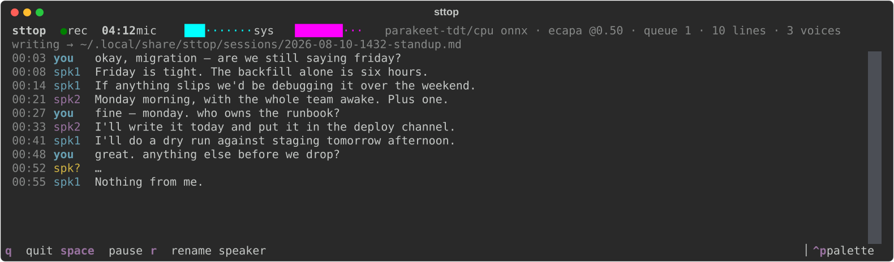

# sttop

sttop transcribes your mic and system audio locally, right in your terminal.
It labels who's speaking and writes a Markdown transcript as you talk.

## Start recording now

```bash
uvx sttop
```



It runs on Linux and macOS and downloads models on the first run. An animated
progress bar shows the current loading stage. Recording starts as soon as audio
devices are ready; speech is buffered in memory while models load, then the
transcript catches up automatically. The TUI shows buffering, catch-up, and live
transcription states. Quitting stops capture and finishes buffered speech before
exiting. Later starts reuse cached models and load transcription and speaker
identification concurrently. You don't need
API keys. On macOS 13+, give your terminal permission in System Settings →
Privacy & Security → Screen & System Audio Recording, then restart the terminal
to capture system audio.

<details>
<summary>Installation options</summary>

To install permanently:

```bash
uv tool install sttop
```

</details>

## Usage

```bash
uvx sttop -t "standup"               # name the session
uvx sttop ls                         # list transcripts in a folder tree
uvx sttop read                       # open the latest transcript
uvx sttop read standup               # find a session by name
uvx sttop follow                     # stream the live transcript, e.g. to an agent
uvx sttop devices --test             # check audio sources
uvx sttop doctor                     # troubleshoot setup
uvx sttop --help                     # all commands and options
```

| Key | Action |
| --- | --- |
| `q` | Name the session and quit |
| `ctrl+c` | Quit without naming |
| `space` | Pause / resume |
| `r` | Rename a speaker throughout the transcript |
| `y` | Copy the transcript so far |

sttop saves each line to `~/.local/share/sttop/sessions/` as it's transcribed.
It labels your mic as "you" and assigns speaker labels to the system audio.

## Customize

Run `uvx sttop config` to create `~/.config/sttop/config.toml`. The comments
explain the settings for audio sources, models, speaker labels, themes, and storage.

sttop uses Parakeet for transcription: MLX on Apple Silicon Macs, ONNX on CPU
on Linux and Intel Macs. Apple Silicon installations include MLX automatically.
Choose explicitly with `sttop --backend mlx` or `sttop --backend onnx`, or set
`backend = "mlx"` / `"onnx"` under `[stt]` in your config. The default is `"auto"`;
it falls back to ONNX if MLX dependencies are missing. Explicit MLX requests and
model-loading failures report an error instead.

The default model is [Parakeet Ultra](https://huggingface.co/moondream/parakeet-ultra),
Moondream's post-trained Parakeet TDT 0.6B v3: same size and speed, lower
word error rate. NVIDIA's v3 and v2 are still available with
`--model nemo-parakeet-tdt-0.6b-v3` or `nemo-parakeet-tdt-0.6b-v2`.

Both engines download weights from Hugging Face on first use and reuse the
local cache. ONNX uses `Masterx/parakeet-tdt-0.6b-ultra-onnx`; MLX uses
[`selcukkubur/parakeet-ultra-mlx`](https://huggingface.co/selcukkubur/parakeet-ultra-mlx).
Switching engines requires a separate model download. The built-in model names
map to their MLX equivalents automatically; other custom ONNX models continue
to use ONNX in auto mode.

The built-in downloads are pinned to specific Hugging Face commits and
limited to the required ONNX or Safetensors weights and configuration files.
These are community conversions of NVIDIA and Moondream weights, not
first-party download repositories. The v2/v3 ONNX conversions are published
by the `onnx-asr` maintainer, and the Ultra one reuses those graphs with the
Ultra weights; the v2/v3 MLX conversions are published by `mlx-community`.
No Python code from model
repositories is loaded. Custom `--model` overrides select your own source and
are not covered by these built-in revision pins. Python dependencies are
resolved with artifact hashes in `uv.lock` for `uv sync --locked` installs.

Speaker labels come from NVIDIA's Nemotron 3 Diarization, an end-to-end model
that tracks up to 8 remote speakers. It runs on CPU through a pinned community
ONNX export, `joosthel/Nemotron-3-Diarization-ONNX`. On the 16 AMI test meetings,
it mislabels 11% of speech time, down from 25% with the previous ECAPA clustering.
It finds 4 speakers per 4-person meeting on average. The older backend is still
available: install `sttop[ecapa]` and set `backend = "ecapa"` under `[diarize]`.

## Encrypted backup

```bash
uvx sttop sync
```

The first run sets up a private Git remote and a vault passphrase. sttop keeps
Markdown files on your machine and syncs encrypted copies after each recording.
Use the same remote and passphrase on another machine to share your transcripts.

Keep a copy of the passphrase. You can't recover the remote backups without it.
Set `storage.encrypt = "always"` to encrypt local transcripts too.

## Updates

sttop checks PyPI in the background and shows an update command when a newer
stable release is available. Checks are cached for six hours; offline checks
never delay recording. Use `uvx sttop@latest` to run the latest release, or
`uv tool upgrade sttop` for a permanent installation.

## Development

```bash
git clone https://github.com/v4rgas/sttop
cd sttop
uv sync --extra dev
uv run sttop
uv run pytest
```

## License

MIT
